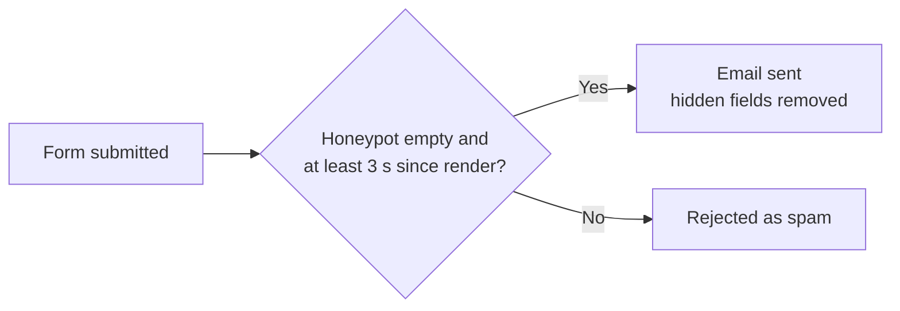

# Custom code

All custom PHP, CSS and JavaScript is stored inside WordPress, in the **WPCode** plugin. Find it under **Code Snippets** in the dashboard. No custom code is kept in files, so changes don't need FTP or a deployment.

WPCode must stay active. If it is deactivated, everything below stops, including the form spam protection.

## Snippets

| Snippet | Type | Runs | What it does |
|---|---|---|---|
| FF: Placeholder Image | PHP | Everywhere | Shows media item `6284` when an entry has no featured image, uses the legacy blank image (`2696`), or its file is missing. Social share tags are not affected. |
| FF: Content Blocks | PHP | Everywhere | Adds blocks after the content on single pages: • **Products:** the spec table, an "Explore" grid of child products, and related products. • **Services and Solutions:** the child grid and related items. • **Resources page:** the product spec directory. |
| FF: Breadcrumbs | PHP | Everywhere | The `[ff_breadcrumbs]` shortcode, used in the Single CPT template (5983). |
| FF: Form Spam Protection | PHP | Everywhere | Checks the hidden form fields (see below). |
| FF: Elementor CPT Support | PHP | Everywhere | Meant to turn on the Elementor editor for the four post types. It currently has no effect, because the setting it filters isn't saved on this site. |
| FF: Site Guide | PHP | Admin only | The read-only Site Guide page. |
| FF: Block Styles | CSS | Site-wide header | Styles for the blocks above. Update it if the brand colours change. |
| FF: Resources Filter | JS | Site-wide footer | The search box and tabs on the Resources page. It does nothing on other pages. |
| FF: Site Guide Menu Style | CSS | Admin header | The teal Site Guide bar in the admin menu. |

## Form spam protection

There are four Elementor forms: Contact, Construction Joints, Slip Testing and Project Enquiry. Protection works without a captcha.

Each form contains a hidden **Spam Trap** block with two fields:

| CSS ID | Rule |
|---|---|
| `ff-hp-website` | A honeypot. It must stay empty; bots fill it in. |
| `ff-hp-ts` | The page render time (Current Date Time tag, format `U`). A submission sent less than 3 seconds after it is rejected. |

To add a new form, copy the Spam Trap block from an existing form and keep both CSS IDs unchanged. The Site Guide flags any form that is missing it.

## Site Guide

This read-only page is the teal item at the top of the admin menu, and only administrators can see it.

The page:

- lists what the custom code does, with a link to each snippet
- shows where each setting is managed
- runs live checks: placeholder image, ACF group, Resources page, a spam trap on each form, whether each snippet is active, and whether GTM is on or paused

## Changing code

- Edit the snippet under **Code Snippets** and click **Update**. WPCode rejects a PHP error when you save, and switches off a snippet that fails later.
- WPCode runs all the "Everywhere" PHP snippets together. A `return` at the top level of one snippet stops the snippets after it, so don't use one.
- When you change a feature, update the "FF: Site Guide" snippet to match.
- Prefix all functions and constants with `ff_` / `FF_`, and escape all output.
- Before larger changes, export the snippets (Code Snippets → Tools → Export) and save the file over `docs/exports/wpcode-snippets.json`. It is a backup only. Nothing loads it, and it can be restored through Tools → Import.
- If you change the content model in ACF, re-export it to `docs/exports/acf-export.json`.
- Tracking code belongs in Google Tag Manager, not WPCode, so that it respects the cookie banner.
- Never commit credentials, database dumps or personal data, because the repository is public.

Administrators can edit and run PHP from the dashboard, so keep the number of administrator accounts small.
