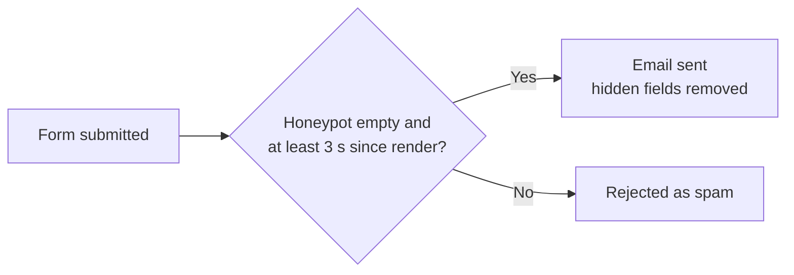

# Custom code

All custom PHP lives in two must-use plugins, in `mu-plugins/`. WordPress loads them automatically, and they can't be deactivated from the dashboard.

## `ff-content-model.php`

| Feature | What it does |
|---|---|
| Placeholder image | Shows media item `6284` when an entry has no featured image, uses the legacy blank image (`2696`), or its file is missing. Social share tags are not affected. |
| Auto-added blocks | Adds blocks after the content on single pages: • **Products:** the spec table, an "Explore" grid of child products, and related products. • **Services and Solutions:** the child grid and related items. • **Resources page:** the product spec directory with a search box. |
| Breadcrumbs | The `[ff_breadcrumbs]` shortcode, used in the Single CPT template (5983). |
| Elementor on CPTs | Turns on the Elementor editor for the four post types. |
| Styles | A small inline `<style id="ff-shortcodes">` block for the blocks above. Update it if the brand colours change. |
| Form spam protection | See below. |

## Form spam protection

There are four Elementor forms: Contact, Construction Joints, Slip Testing and Project Enquiry. Protection works without a plugin or a captcha.

Each form contains a hidden **Spam Trap** block with two fields:

| CSS ID | Rule |
|---|---|
| `ff-hp-website` | A honeypot. It must stay empty; bots fill it in. |
| `ff-hp-ts` | The page render time (Current Date Time tag, format `U`). A submission sent less than 3 seconds after it is rejected. |

To add a new form, copy the Spam Trap block from an existing form and keep both CSS IDs unchanged. The Site Guide flags any form that is missing it.

## `ff-site-guide.php`

This adds a read-only **Site Guide** page, the teal item at the top of the admin menu. It is visible to administrators only.

The page:

- lists what the custom code does and where each setting is managed
- runs live checks: placeholder image, ACF group, Resources page, a spam trap on each form, and whether GTM is on or paused
- shows no code and has no inputs

## Rules for changing code

- When you change `ff-content-model.php`, update `ff_site_guide_features()` in `ff-site-guide.php` to match.
- Prefix all functions and constants with `ff_` / `FF_`, and escape all output.
- Throwaway scripts go in `mu-plugins/ff-tmp-*.php`. That pattern is git-ignored. Delete them after use.
- If you change the content model in ACF, re-export it to `docs/exports/acf-export.json`.
- Never commit credentials, database dumps or personal data, because the repository is public.
