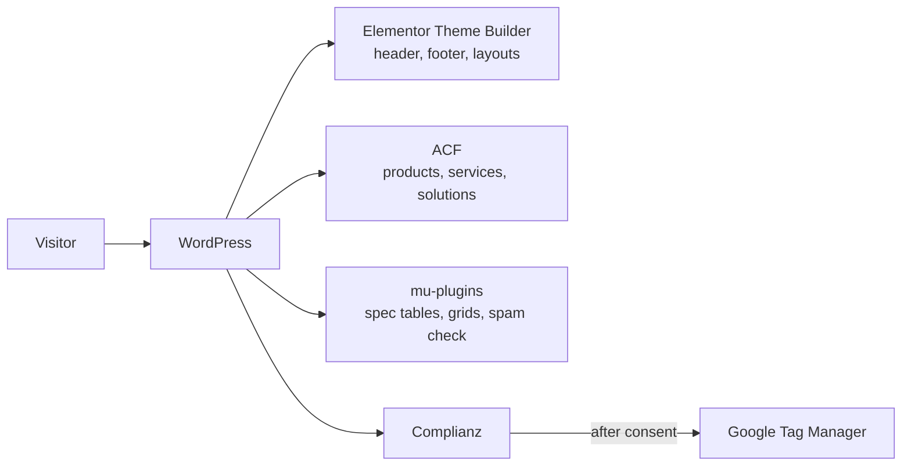

# How the site works

## Where things are managed

Almost everything is set in the dashboard. Only the last row of this table is code.

| What | Where |
|---|---|
| Header, footer, page layouts | Templates → Theme Builder (Elementor) |
| Page content | Pages → Edit with Elementor |
| Products, Services, Solutions, Our Work | Their own admin menus (ACF post types) |
| Product specs and related items | ACF fields on each entry |
| Colours, fonts, reusable styles | Elementor global variables and classes (`ff-*`) |
| Menus | Appearance → Menus |
| Forms: fields, recipients, subject | The form widget on each page, in Elementor |
| SEO titles, descriptions, sitemaps | Yoast SEO |
| Cookie banner and Google Tag Manager | Complianz |
| Redirects | Tools → Redirection |
| Spec tables, product grids, breadcrumbs, placeholder image, spam checks | `mu-plugins/ff-content-model.php` |

The admin **Site Guide** page shows this same map, plus live status checks.

## Content model

These are defined in ACF. An exported copy is in [`exports/acf-export.json`](exports/acf-export.json), which can be imported through ACF → Tools.

| Post type | Key | Notes |
|---|---|---|
| Products | `product` | Hierarchical: range → sub-range → product. URLs are `/product/<parent>/<slug>/` |
| Services | `services` | Hierarchical |
| Solutions | `solutions` | Hierarchical |
| Our Work | `our_work` | Case studies |

**Product Types** (`product_type`) is a taxonomy on products.

There are two field groups:

- **Product Specifications** has 8 WYSIWYG fields (`ff_reference`, `ff_usage`, `ff_dimensions`, `ff_material`, `ff_installation`, `ff_performance`, `ff_colours`, `ff_accessories`). Each field's label becomes a row heading in the spec table, and empty fields are hidden.
- **Related Products** has one field, `ff_related`, which shows a card grid. It is used on products, services and solutions.

Post content is plain text. The spec table, the child-product grid and the related grid are added automatically by code, so no shortcodes are needed in content.

## Templates

These are Theme Builder templates; the IDs are WordPress post IDs.

| Template | ID | Used for |
|---|---|---|
| Header / Footer | 5710 / 5711 | Entire site |
| Single CPT | 5983 | All products, services, solutions and Our Work entries |
| Product Type Archive | 6196 | `/product/` and `/product_type/…` |
| Case Study | 6217 | 18 case-study pages, each added to its display conditions |
| Wide Content Page | 6246 | Resources page |
| Text Page | 5720 | Privacy Policy, Terms & Conditions |
| Single Post / Blog Archive / Search / 404 | 5716 / 5717 / 5718 / 5719 | Blog and system pages |

Other pages (Home, Contact, FAQ, the hub pages and the form pages) have their own Elementor layouts.

## Good to know

- **After style changes**, clear the Elementor cache (Elementor → Tools → Clear Files & Data), or new classes won't show.
- **Modifier classes must sit above their base class.** In Elementor's class list, modifiers such as `ff-btn-primary` have to come before the base class (`ff-btn`), or they won't take effect.
- **Fonts** are served locally, so the site makes no requests to Google Fonts.
- **Construction Joints is noindex on purpose.** The page is set to noindex to match the live site.
- **Hub URLs are hard-coded in the breadcrumbs.** If you rename the hub pages (`/products/`, `/services/`, `/solutions/`, `/recent-work/`), update the URLs in `[ff_breadcrumbs]`.
